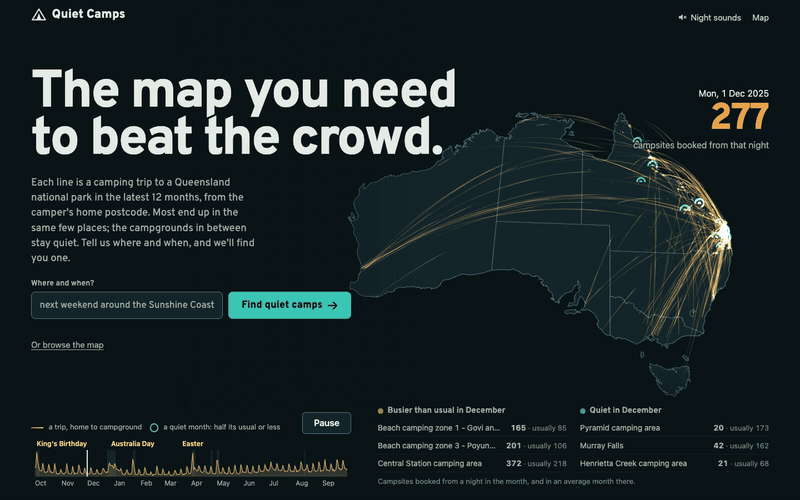
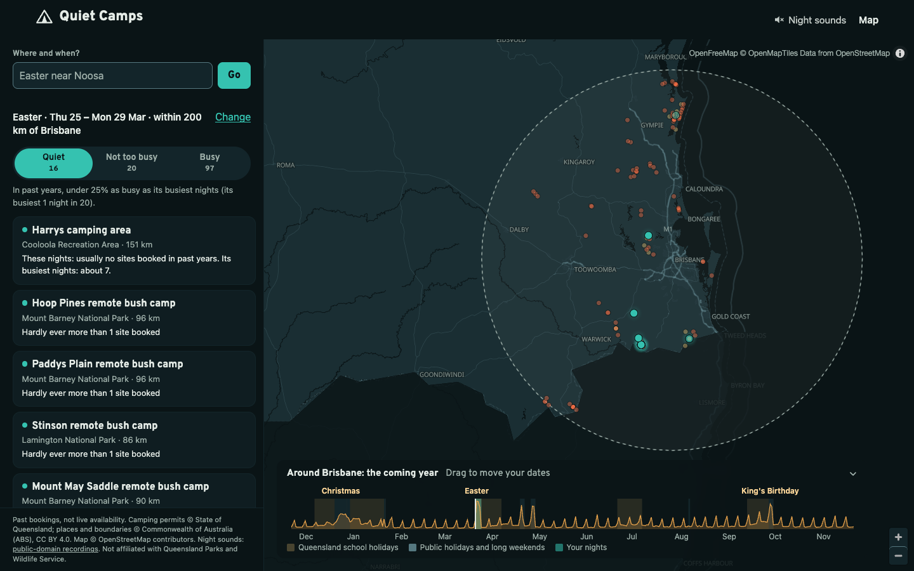
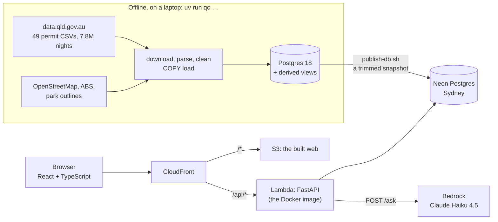

# Quiet Camps

Queensland camping since 2011, read from the permits: where people travel from, when the crowds arrive, and which campgrounds are usually quiet on your dates.

A learning project with Python (FastAPI, SQLAlchemy, Postgres) and React, built on every public camping permit since 2011 from Queensland Parks and Wildlife Service.

**Live: https://quiet-camps.idoescode.com**



## What it does

- **The homepage** plays the latest 12 months of camping trips: each trip is a line from the
  camper's home postcode to its campground, arriving on its first night.
- **The explorer** (`/explore`) maps the campgrounds that are usually quiet, not too busy or
  busy on your dates, compared with each campground's own history, near a place if you like.
  Type "Easter, near Noosa" and Claude Haiku reads it into dates and a place.
- **A page per campground:** its typical year night by night, how far ahead people book, and
  how it has changed year on year.



## How it fits together



- **API** (`api/`): FastAPI with async SQLAlchemy 2.0 and psycopg 3; raw SQL for the heavy
  queries (gaps and islands for trips, window functions for typical nights), Pydantic models
  at the edges, errors as RFC 9457 problems. pyright strict, ruff, pytest against a real
  Postgres.
- **Data** (`api/src/quiet_camps/ingest`, `db`): 11 CSV layouts in 49 files, two encodings,
  loaded with `COPY`; one row per site per night ([ADR 0001](docs/adr/0001-one-record-per-camp-night.md)),
  and "quiet" relative to each campground's own history, since there's no capacity data
  ([ADR 0002](docs/adr/0002-relative-busyness-without-capacity-data.md)).
- **Web** (`web/`): Vite, React, TanStack Router and Query, MapLibre, three.js for the
  homepage; its API types are generated from the committed OpenAPI document, and CI fails if
  they drift.
- **Deploy** (`deploy/aws/`): CloudFormation for CloudFront, S3 and Lambda; Postgres
  on Neon ([ADR 0006](docs/adr/0006-deploy-on-lambda-cloudfront-and-neon.md)).

## Data and attribution

- Camping permits: [Camping and vehicle permits](https://www.data.qld.gov.au/dataset/camping-and-vehicle-permits), © State of Queensland, licensed under [CC BY 4.0](https://creativecommons.org/licenses/by/4.0/).
- Campground locations: © [OpenStreetMap](https://www.openstreetmap.org/copyright) contributors, available under the [Open Database Licence](https://opendatacommons.org/licenses/odbl/).
- Park outlines: [Protected areas of Queensland](https://www.data.qld.gov.au/dataset/protected-areas-of-queensland-series), © State of Queensland, licensed under [CC BY 4.0](https://creativecommons.org/licenses/by/4.0/).
- Postcode centres, suburbs and localities, and council areas: [ABS Australian Statistical Geography Standard 2021](https://www.abs.gov.au/statistics/standards/australian-statistical-geography-standard-asgs-edition-3), © Commonwealth of Australia, licensed under [CC BY 4.0](https://creativecommons.org/licenses/by/4.0/).
- Queensland state school holidays, late 2022 to 2029: [Department of Education](https://education.qld.gov.au/about-us/calendar/term-dates), © State of Queensland; the past years from its term-dates page as archived by the [Internet Archive](https://web.archive.org/web/2025/https://education.qld.gov.au/about-us/calendar/term-dates). Kept as a short reviewed list in `api/src/quiet_camps/ingest/qld_school_holidays.csv`, with each source in its header.
- Page views on the live site are counted with [GoatCounter](https://www.goatcounter.com): no cookies and no personal data, and only the page's path, never its search (the dates and place someone looked for).
- The data shows **past bookings**, not live availability. "Quiet" means quiet compared with that campground's own history.

This project is not affiliated with or endorsed by Queensland Parks and Wildlife Service or the Queensland Government.

## Run it locally

```sh
docker compose up -d   # Postgres 18

cd api
uv run alembic upgrade head
uv run qc download && uv run qc load   # the permits from data.qld.gov.au
uv run qc locations --fetch            # campground locations from OSM and park outlines
uv run qc postcodes --fetch            # where campers come from, for the homepage's map
uv run qc places --fetch               # Queensland towns and council areas, to search near
uv run uvicorn quiet_camps.api.app:create_app --factory --port 8000

cd ../web
pnpm install && pnpm dev               # http://localhost:5173; add --host to open it on your LAN
```

The API documents itself at http://localhost:8000/docs. The web client's types are
generated from that contract: see [web/README.md](web/README.md).

Or run the API from its Docker image, beside Postgres:
`docker compose --profile full up -d --wait` (http://localhost:8000).

### Checks

The same as CI ([.github/workflows/ci.yml](.github/workflows/ci.yml)), which also builds the
Docker image, checks it doesn't run as root, migrates an empty database and waits for
`/health`:

```sh
cd api && uv run ruff check && uv run ruff format --check && uv run pyright && uv run pytest
cd web && pnpm typecheck && pnpm lint && pnpm test && pnpm api:check && pnpm build
```

### Plain-words search (optional, AWS)

"Where and when?" boxes send what you type to `POST /ask`, which reads it with Claude Haiku 4.5
on Amazon Bedrock ([ADR 0005](docs/adr/0005-natural-language-search-on-bedrock.md)). It's off
unless switched on, and the site works without it: the dates and place can always be set by
hand.

1. An AWS account with Amazon Bedrock, and a profile on this machine whose identity may call
   `bedrock:InvokeModel` on the `au.anthropic.claude-haiku-4-5-20251001-v1:0` inference
   profile (Sydney, keeping the words in Australia).
2. `cp api/.env.example api/.env`, set `AWS_PROFILE`, then start the API with
   `--env-file .env`.
3. Set a budget alert, so a surprise is an email, not a bill: AWS console → Billing and Cost
   Management → Budgets → Create budget → Monthly cost budget, e.g. US$5, with your email.

Each new phrasing is one call, about a tenth of a US cent; the same words again that day come
from a cache. The API allows 20 asks an hour per visitor and 300 a day for the whole site
(counted in Postgres, so the limits hold however many copies of the API run), and never stores
or logs the words.

## Deploy (AWS)

`deploy/aws/` puts the site on CloudFront, S3 and Lambda in Sydney, with Postgres on Neon
([ADR 0006](docs/adr/0006-deploy-on-lambda-cloudfront-and-neon.md)):

```sh
cp deploy/aws/.env.example deploy/aws/.env   # AWS profile, Neon URL, a secret
deploy/aws/publish-db.sh build && deploy/aws/publish-db.sh load   # the snapshot into Neon
deploy/aws/ship.sh bootstrap                 # once: the image repository
deploy/aws/ship.sh deploy                    # image, stack and web; prints the URL
deploy/aws/ship.sh status                    # health and this month's cost
deploy/aws/ship.sh teardown                  # delete it all
```

**Cost:** close to nothing while traffic is low. Lambda, CloudFront and Neon's free tiers
cover it; the image repository is a few cents a month; each new `/ask` phrasing is about a
tenth of a US cent. The deploy doesn't create a budget: set one for the account (step 3
above), so a surprise is an email, not a bill.

**Real vs. trimmed:** the public database holds every derived number since 2011, but only the
permit rows from October 2023 on, which is all the site reads (350 MB instead of 1.8 GB). It's
a snapshot: it changes when it's rebuilt and loaded again.

## How it was built

Built step by step with [Claude Code](https://claude.com/claude-code) under my direction, as a
way to learn Python's web and data stack. I set the direction and made the design decisions
throughout; who wrote the code:

- **I wrote:** the project tooling (uv, ruff, pyright strict, pytest); the CKAN client and
  downloader with its retry decorator; most of the CSV parsers; the SQLAlchemy models and the
  Alembic setup; the area upsert and the load runner; the FastAPI app factory, `/health` and
  typed settings; the search's query model; the campground endpoint (service, repository and
  route).
- **Claude Code wrote, at my request:** the rest of the API (the other endpoints, the COPY
  loader, the derived views, campground locations, `/ask`), all of the React front end, and
  the Docker image, CI and AWS deploy. I reviewed it and directed the changes.

The decisions and their reasons are in [docs/adr](docs/adr).
